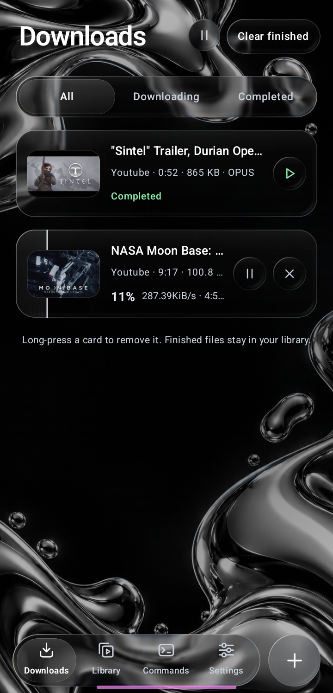
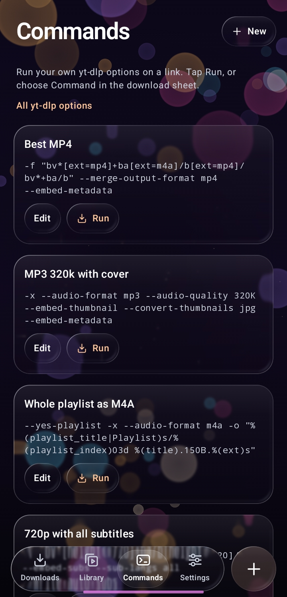
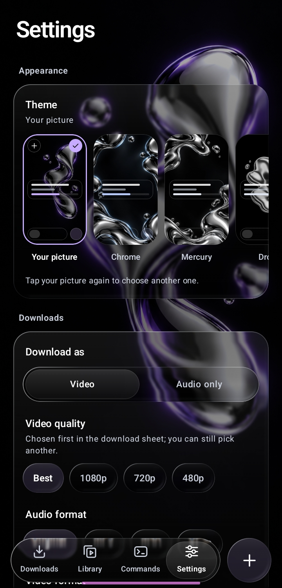

<p align="center">
  
</p>

<h1 align="center">Glint</h1>

<p align="center">
  A video and audio downloader for Android, under liquid glass.<br>
  Built on <a href="https://github.com/yt-dlp/yt-dlp">yt-dlp</a>. Free and open source: no ads, no accounts, no tracking.
</p>

<p align="center">
  <a href="../../releases/latest"><b>Download the latest release</b></a>
</p>

<p align="center">
  
  
  
</p>

## Features

**Download**

- Everything yt-dlp supports: YouTube and thousands of other sites. yt-dlp updates from inside
  the app, from its stable or nightly channel.
- When yt-dlp cannot get a link, Glint tries other ways: [gallery-dl](https://github.com/mikf/gallery-dl)
  for pictures, albums and posts (Instagram, X, Pinterest, Reddit, Tumblr, Imgur and more), and for
  Facebook and Instagram videos a hidden browser that uses your sign-in and finds the video as the
  page plays it.
- Share a link from any app and a glass sheet opens over that app. Or tap + and paste a link,
  or type words to search YouTube.
- Every link is read first: a preview, the real qualities with their file sizes, and every
  format yt-dlp found.
- Video, or audio only as MP3, M4A, OPUS or the original format.
- Playlists and channels: pick the videos you want; they download into their own folder.
- Trim a clip or pick chapters, each chapter as its own file or several joined into one, with
  optional frame-exact cuts.
- Pause, resume and retry. Downloads continue after the app closes, in an ordered queue with a
  chosen number at once.

**Follow**

- Follow channels and playlists: new videos download by themselves, checked in the background
  every few hours, on Wi-Fi only if you like.

**Library and commands**

- A searchable library of finished files to play, share, open at their source or delete.
- Commands: save your own yt-dlp options and run them on any link.

**Settings**

- Default type, quality and audio format, and a most-compatible H.264/AAC mode.
- Faster downloads (several parts at once), folders by type or by site.
- Save to Download, to Movies and Music, or to any folder, memory cards included.
- Embedded subtitles and automatic captions, cover art and metadata, SponsorBlock.
- Sign in to sites inside the app, or import cookies.txt, for private and age-restricted videos.
- Proxy, speed limit, and notifications when downloads finish or fail. A failed download says
  what went wrong in plain words, with yt-dlp's full output underneath.

**Look**

- Liquid glass: GPU lens refraction on Android 13 and newer, live frosted glass on Android 12, and
  translucent glass on older versions.
- Six themes, three of them liquid metal, or your own picture as the background; the glass takes
  its colours from it.
- The share sheet blurs the app behind it on Samsung Galaxy phones and on phones with Android's
  window blur, and turns solid where blur is unavailable.
- 30 languages. Glint follows the phone's language.

## Download

Get the APK from the [latest release](../../releases/latest). Glint needs Android 7.0 or newer.

| APK | For |
| --- | --- |
| `arm64-v8a` | Almost every phone from the last several years. Start here. |
| `armeabi-v7a` | Older and low-cost phones running 32-bit Android |
| `x86_64` | Emulators and Intel or AMD Chromebooks |
| `universal` | Any device, but the largest download |

If the phone says the app could not be installed, try `armeabi-v7a`, or `universal`.

Every release is signed with the same key, so new versions install over old ones. Its SHA-256
certificate fingerprint is:

```
86:17:9F:03:6D:B3:5C:24:37:B5:88:D7:B4:76:C5:D9:10:C2:A6:B1:A5:F7:0C:C3:B5:67:6A:4D:EC:40:7B:67
```

Glint does not check for its own updates yet. To be told about new versions, add this
repository's address to [Obtainium](https://github.com/ImranR98/Obtainium), which installs
updates from GitHub releases.

## Privacy

Glint has no ads, analytics or accounts, and sends nothing about you anywhere. It connects only
to the sites you download from, to GitHub to update yt-dlp, to PyPI to update gallery-dl, and,
when SponsorBlock is turned on, to SponsorBlock's server for the segments of a video. The hidden
browser runs on the phone, with the sign-in you made in Glint's own browser. Cookies from signing in stay on the phone.
If Glint crashes, the error is kept on the phone and shown the next time it opens, for you to
copy and send if you choose.

## Building

Requires JDK 21 and the Android SDK (platform 35).

```sh
./gradlew :app:assembleDebug                         # debug APKs for every processor type
./gradlew :app:assembleDebug -Pglint.abi=arm64-v8a   # one processor type, faster
./gradlew :app:testDebugUnitTest :app:lintDebug      # tests and lint
./gradlew :app:assembleRelease                       # optimized APKs
```

Without the release key, release builds are signed with your debug key. How the signed releases
are built and published is in [docs/RELEASING.md](docs/RELEASING.md). Themes and the glass are
explained in [docs/THEMES.md](docs/THEMES.md).

## Translations

The translations live in `app/src/main/res/values-*/strings.xml`. They were written without
review by native speakers, so corrections are very welcome: open an issue or a pull request with
the better wording.

## Credits

- [yt-dlp](https://github.com/yt-dlp/yt-dlp), which does the downloading
- [youtubedl-android](https://github.com/JunkFood02/youtubedl-android), which brings yt-dlp,
  Python and [FFmpeg](https://ffmpeg.org) to Android
- [gallery-dl](https://github.com/mikf/gallery-dl), for pictures and posts yt-dlp does not get,
  shipped with [requests](https://github.com/psf/requests) and its helpers
- [Seal](https://github.com/JunkFood02/Seal), the downloader that inspired Glint
- [Coil](https://github.com/coil-kt/coil) for images

## Disclaimer

Glint is a tool. Download only what you have the right to download, and respect the terms of the
sites you use.

## License

Glint is free software under the [GNU General Public License v3](LICENSE).
